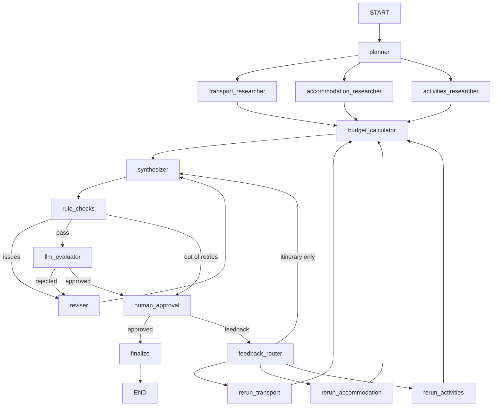

# AI Travel Planner

A multi-agent travel planner built with LangGraph. Agents research transport,
stays, and activities on the web; **Python code** calculates the budget and
checks the plan; an LLM reviews quality; and **you** approve or request changes.

## How it works



| Step | Type | Job |
|---|---|---|
| planner | LLM | Writes research tasks for each researcher |
| 3 researchers | LLM agent + web search | Return one recommended plan as cost items, plus alternatives |
| budget_calculator | Python | `amount × quantity × (travelers if per_person else 1)`, category totals, over/under budget |
| synthesizer | LLM | Day-by-day itinerary with warnings and suggestions, but no prices |
| rule_checks | Python | Dates, budget warning, travel time vs trip length, pace, stays match the research |
| llm_evaluator | LLM | Interests, food preference, special requirements, realism |
| human_approval | You | Approve, or describe what should change |
| feedback_router | LLM | Picks transport, accommodation, activities, or itinerary-only |

## Setup

Requires [uv](https://docs.astral.sh/uv/) and Python 3.14.

```bash
uv sync
cp .env.example .env
```

Add your keys to `.env`: a [Groq](https://console.groq.com) key and a [Tavily](https://tavily.com) key.
Any `init_chat_model` provider works if you change `LLM_MODEL` and install its package.

## Running

**Web app** (two terminals):

```bash
uv run uvicorn main:app
```

```bash
uv run streamlit run frontend/streamlit_app.py
```

Open http://localhost:8501. API docs are at http://localhost:8000/docs.

**React frontend** (instead of Streamlit, see `frontend-react/README.md`):

```bash
cd frontend-react && npm install && npm run dev
```

Open http://localhost:5173.

**Terminal** (plans `app/sample_trip.py` and asks you to approve):

```bash
uv run run_graph.py
```

`--review` reuses the research saved in `last_run.json` (no web searches),
`--auto-approve` skips the approval prompt, and `--resume <thread_id>` continues
a run that failed (the failure message prints the exact command).

**Tests** (no API keys or network needed):

```bash
uv run pytest
```

## API

| Method | Path | Description |
|---|---|---|
| `POST` | `/trips` | Start planning. Returns `202` with a `thread_id` |
| `GET` | `/trips/{thread_id}` | Status (`running`, `waiting_for_approval`, `approved`, `rejected`, `failed`), itinerary, budget |
| `POST` | `/trips/{thread_id}/approval` | `{"approved": false, "feedback": "cheaper hotel"}`. Returns `409` if the trip is not waiting |
| `POST` | `/trips/{thread_id}/retry` | Continue a `failed` trip from its last saved step |
| `GET` | `/health` | Health check |

## Evaluation

`eval/trips.json` has 10 trips: tight and generous budgets, 1–4 travelers,
2–6 days, and special requirements. The script runs the single-prompt
`baseline.py` and the graph on each and writes `eval/results.md`.

```bash
uv run python -m eval.run_eval --limit 3
```

Leave out `--limit` for all 10 trips. Cost: about 9 Tavily searches and 20–30
LLM calls per trip, roughly 5 minutes each on the Groq free tier. The free tier's
daily token limit allows only a few trips per day, so run 3 trips a day or use a paid tier.

Results: run the evaluation and summarise `eval/results.md` here.

## Known limitations

- **Slow and limited on free tiers.** Groq's free tier allows about 8,000 input and 1,000 output tokens per minute, so `app/llm.py` spaces calls 10 seconds apart and a full plan takes about 5 minutes. It also allows 200,000 tokens per day, which is only a few full plans. When a limit is hit, the trip fails and can be retried later.
- **A URL is not proof.** Prices come from search snippets. A source can be a blog, or a page for a different route. All prices are labelled as estimates unless the source shows them.
- **Rule checks are heuristics.** Stay matching compares hotel names by words, and warnings are checked by keywords.
- **`end_date` means the last day at the destination**, not the day you get home. A 36-hour train home is a warning, not an error.
- **Single process.** Running and failed trips are tracked in memory, and checkpoints are in a local SQLite file. Restarting the API loses the "running" and "failed" markers; use Postgres and a task queue for production.

## Project structure

```
app/
  graph.py          LangGraph wiring, routing, SQLite checkpointer
  runner.py         Background runs and status for the API
  state.py          TravelState and initial state
  render.py         Itinerary → Markdown
  llm.py            Model setup and rate limiter
  nodes/            planner, researchers, budget, synthesizer, rule_checks,
                    llm_evaluator, human_approval, feedback_router, review_steps
  schemas/          Pydantic models for LLM output
  prompts/          System prompts
  tools/            Tavily web search tool
  api/              FastAPI routes and request schemas
frontend/           Streamlit app
frontend-react/     Vite + React + TypeScript app (same features)
eval/               Evaluation trips, metrics, and runner
tests/              Unit and integration tests (no API calls)
baseline.py         Single-prompt baseline
run_graph.py        Terminal runner
main.py             FastAPI app
```
